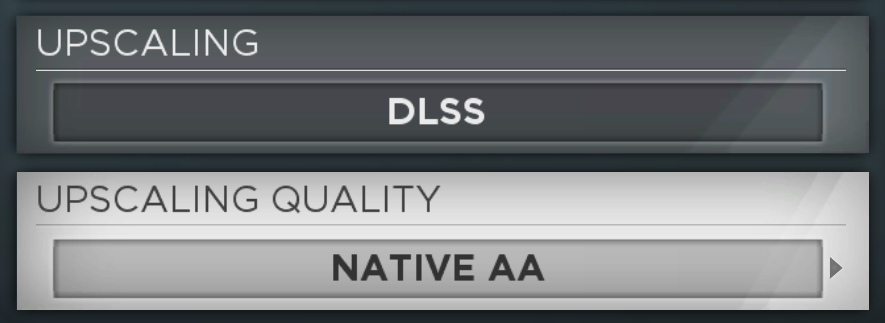

# NFS13Fix

NFS13Fix is a plugin for the PC version of Need for Speed: Most Wanted (2012) that fixes several long-standing issues with the port
and adds a few modern options. The game runs in a borderless window instead of exclusive fullscreen, the 60 FPS cap is removed
without the game speeding up, and any controller supported by SDL works out of the box.
It also adds DLSS and FSR, and a simple mod loader: files placed in a `mods` folder next to the game replace the game's own files,
with no repacking needed. SpeedLists can also be played alone in friends-only and invite-only online games,
and a car the game does not have (such as another player's add-on car) loads a stand-in instead of freezing.

## Features

* Borderless window (a lower resolution sits centred on the desktop)
* Unlocked frame rate
* SDL controller input
* DLSS and FSR
* Mod loader
* Solo SpeedLists in private games
* Stand-in car for vehicles the game does not have
* Fewer random Autolog disconnects

## Installation

Install [Ultimate ASI Loader](https://github.com/ThirteenAG/Ultimate-ASI-Loader/releases) (32-bit)

Then extract the release archive into the game directory. Settings are stored in `NFS13Fix.ini`, created on first launch.

## Controllers

To use the SDL controller support, turn off Steam Input for the game (Steam > the game's Properties > Controller >
Disable Steam Input). With Steam Input on, Steam takes over the controller and the game only sees Steam's own virtual pad.

## The mods folder

The release ships with a `mods` folder that adds upscaling options to Settings > Graphics. If another mod already replaces the settings
screen or the game's text, leave it out; upscaling can still be configured in `NFS13Fix.ini`.

### Adding the upscaling options to another mod

A mod that ships its own settings screen or text replaces the `mods` folder files above. It can carry the two rows itself:
NFS13Fix provides the settings, and the rows are plain data. Everything below is relative to the retail (vanilla) files.

NFS13Fix adds two graphics settings to the game's own settings map. The menu reads, changes and applies them like any
built-in setting:

| setting | values |
|---|---|
| 14, method | 0 off, 1 DLSS, 2 FSR |
| 15, quality | 0 native AA (DLAA with DLSS), 1 quality, 2 balanced, 3 performance, 4 ultra performance |

**Settings screen.** In `UI\SCREENS2\469958.BNDL`, Genesys object `0x72bc6` holds the `GfxSettings` category, whose list
of rows (field `0x9b416e3f`) ends with SUPER SAMPLING (label string `0x23f321`, setting 13). Insert two copies of that row
after it, so they keep its "needs Apply" flag, and change these fields:

| field | hash | UPSCALING | UPSCALING QUALITY |
|---|---|---|---|
| extra string | `0x142a8f98` | 0 | 0 |
| label | `0x43bdad22` | `0x7fe5550d` | `0x7fcd5243` |
| options | `0xde1544a3` | `0x1cdb9` (retail OFF), `0x7fa114d2`, `0x7f5e3209` | `0x7f68e8b1`, `0x7f7dd8c4`, `0x7f96981e`, `0x7f0e4493`, `0x7f17cf8c` |
| option count | `0x63d5e568` | 3 | 5 |
| setting index | `0x50522185` | 14 | 15 |

Options are listed in value order. Every other row stays as it is.

**Text.** Add the new strings to every `UI\LANGUAGE\00NN.BNDL` string table, keeping its ids sorted:

| id | text |
|---|---|
| `0x7fe5550d` | UPSCALING |
| `0x7fa114d2` | DLSS |
| `0x7f5e3209` | FSR |
| `0x7fcd5243` | UPSCALING QUALITY |
| `0x7f68e8b1` | NATIVE AA |
| `0x7f7dd8c4` | QUALITY |
| `0x7f96981e` | BALANCED |
| `0x7f0e4493` | PERFORMANCE |
| `0x7f17cf8c` | ULTRA PERFORMANCE |

The ids are arbitrary (outside the retail range); NFS13Fix only looks at the setting index. The bundles in this release's
`mods` folder are exactly the retail files with these changes, and can serve as a reference.

Settings 14 and 15 only exist while NFS13Fix is loaded. A settings screen with these rows crashes the game without it,
so a mod that adds them requires NFS13Fix.

## Compilation requirements

* Visual Studio 2022 with the C++ desktop workload, CMake 3.21 or newer and the Windows SDK.
* SDL3, included as a submodule. Clone with `--recurse-submodules`.
* libmem, the DLSS SDK and the FidelityFX SDK, downloaded into `external` by `fetch_deps.ps1`.

Run `fetch_deps.ps1`, then `build.ps1`. Use `build.ps1 -Deploy -GameDir <path>` to copy the result into the game directory.

## License

NFS13Fix is licensed under the AGPL-3.0, as it links [libmem](https://github.com/rdbo/libmem).
